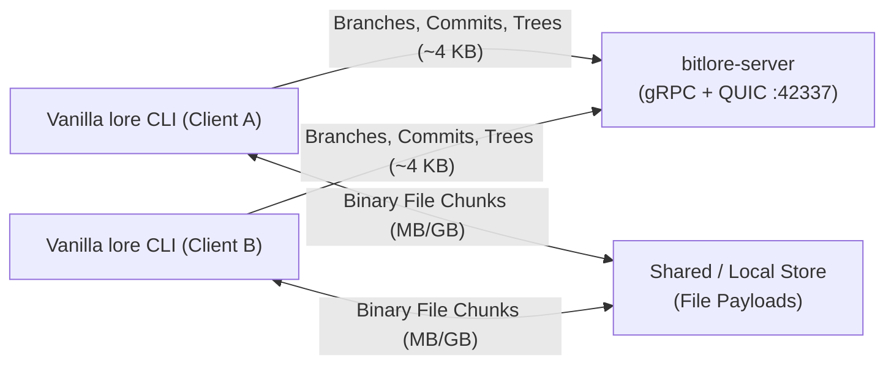
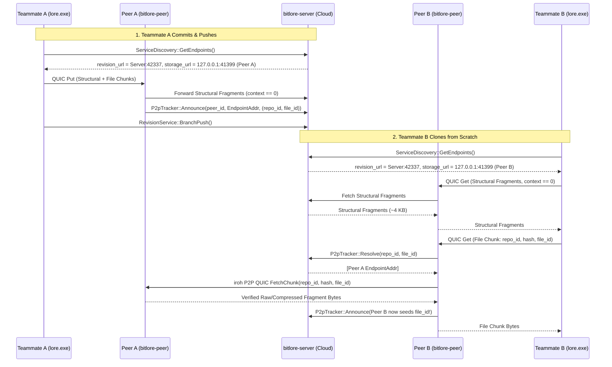

# Bitlore Architecture

Bitlore is a **metadata-only hosting server and peer-to-peer (P2P) swarm platform** for the Lore version control system. It enables studios and globally distributed teams to host repository history, branches, locks, and directory trees on a lightweight central server (`bitlore-server`, ~1–5 KB per commit) while transferring multi-gigabyte binary assets directly between teammates over NAT-traversed QUIC (`bitlore-peer` powered by [`iroh`](https://iroh.computer)).

Crucially, Bitlore requires **zero modifications** to the upstream Lore client or server and works out-of-the-box with **100% unmodified vanilla `lore` CLI binaries**.

---

## 1. Structural vs. File Content Separation

In Lore's content-addressed storage layer, every immutable fragment is addressed by a 48-byte [`Address`](../src/types.rs):

```text
Address (48 bytes) = Hash (32 bytes BLAKE3) + Context (16 bytes UUID/Tag)
```

Lore's client pipeline assigns `Address.context` deterministically based on the kind of data being written:

| Fragment Category | `Address.context` | Examples | Typical Size | Stored on `bitlore-server`? |
| :--- | :--- | :--- | :--- | :--- |
| **Structural / Metadata** | `Context::ZERO` (`[0u8; 16]`) | `StateData` (commit header), `Tree` (Merkle nodes), `NodeBlock`, `NameTable`, `NodeFileMetadataBlock`, `Metadata` | ~1–5 KiB / commit | **Yes (Durably Stored)** |
| **File Content Payloads** | Non-zero UUIDv7 `file_id` | Leaf file chunks (≤256 KiB) and multi-chunk `FragmentReference` lists for large binary assets | Megabytes to Terabytes | **No (Metadata / P2P Only)** |

Because every file content fragment carries its file's non-zero `file_id` in `Address.context`, `bitlore-server` can distinguish structural Merkle-tree metadata from bulk file payloads at the storage protocol boundary without inspecting or decompressing file contents.

---

## 2. System Topology

Bitlore supports two operating modes with vanilla `lore` clients:

### Mode A: Direct Metadata-Only Hosting (Shared Drive / Local Cache / Bare Clones)

Clients connect directly to `bitlore-server`. Structural fragments are stored on `bitlore-server`, while file payloads remain in the client's local `.urc/immutable` store or team shared store (`--use-shared-store`).



### Mode B: Full P2P Swarm (`bitlore-server` + `bitlore-peer` Sidecar)

Each teammate runs a lightweight `bitlore-peer` daemon locally (e.g., on `127.0.0.1:41399`). When the vanilla `lore` CLI queries `ServiceDiscovery` on `bitlore-server`, `bitlore-server` returns its own address for `api_url` / `revision_url` / `repository_url`, and returns `lore://127.0.0.1:41399` as the `storage_url`.



---

## 3. How Vanilla `lore` Clients Interact with `BitloreMetadataStore`

[`BitloreMetadataStore`](../src/store.rs) implements [`ImmutableStore`](../src/local_store.rs) on `bitlore-server` with specific behaviors tailored to vanilla `lore` clients:

1. **`query(partition, addresses, resolved)`**:
   - **Structural (`context.is_zero()`)**: Queries `bitlore-server`'s local disk store. Returns `MatchNone` if missing so `lore push` uploads the commit's Merkle tree.
   - **File Content (`!context.is_zero()`)**: Returns `StoreMatch::MatchFull` (`QueryStatus::ExistFullMatch = 0`). During `lore branch push`, the client sees that the server "already holds" the file fragments, skips uploading multi-gigabyte file payloads over the wire, and marks them present locally.
2. **`put(partition, address, fragment, data, ...)`**:
   - **Structural (`context.is_zero()`)**: Validates and writes the fragment to `bitlore-server`'s local store.
   - **File Content (`!context.is_zero()`)**: Records the 16-byte [`Fragment`](../src/types.rs) header in `file_metadata_index` and returns `Err(StoreError::NotSupported)`. When a user runs an online `lore commit` without `--local`, `NotSupported` causes the vanilla client's `write_tracker` to set `stored_durable = false`, ensuring the client writes and retains the file payload in its own local/shared store instead of evicting it.
3. **`get_metadata(partition, address)`**:
   - During `RevisionService::BranchPush`, the server validates the pushed commit state. If a file fragment's 16-byte header was cached in `file_metadata_index`, `get_metadata` returns it with `PayloadStoredDurable`; otherwise it synthesizes a valid durable metadata header so branch pushes and fast-forward updates succeed without holding file bytes on the server.
4. **`get(partition, address)`**:
   - **Structural (`context.is_zero()`)**: Serves the full fragment payload from `bitlore-server`.
   - **File Content (`!context.is_zero()`)**: Returns `Err(StoreError::PayloadNotFound)`, which maps to `QuicServiceError::NotFound` (`4`) over QUIC.

---

## 4. Swarm Seeding & Resilience (`BitlorePeerStore`)

When Teammate B fetches a missing file chunk through [`BitlorePeerStore`](../src/peer_store.rs):
1. `BitlorePeerStore` checks its local disk cache first.
2. On a cache miss for a file chunk (`!address.context.is_zero()`), `BitlorePeerStore` calls `P2pTracker::Resolve(repo_id, file_id)` on `bitlore-server` (with a 15-second local resolution cache so multi-chunk files only query the tracker once).
3. `BitlorePeerStore` dials candidate peers concurrently via [`BitloreIrohNode::fetch_chunk_from_peer`](../src/p2p_node.rs) over `iroh` hole-punched QUIC (`ALPN = bitlore/p2p-chunk/0.1`).
4. Upon receiving the chunk, `BitlorePeerStore` recomputes its BLAKE3 content hash (`hash_fragment`, decompressing LZ4/Zstd if compressed) and verifies it against `address.hash` before storing it locally.
5. `BitlorePeerStore` immediately announces `(repo_id, file_id)` back to the tracker, turning Teammate B into a seeder for Teammate C even if Teammate A goes offline.
